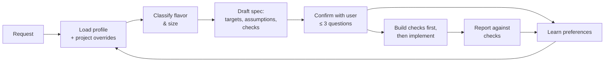

# spec-expander

**Turn short, ambiguous requests into precise, verifiable specs — before any code is written.**

`spec-expander` is a [Claude Code](https://claude.com/claude-code) skill. When you ask for something like *"build an efficient API"*, it expands the request into an explicit specification: concrete numeric targets, scoped requirements, labeled assumptions, a small set of high-impact questions, and a runnable check for every requirement. It also learns your preferences over time, so each spec needs fewer questions than the last.

---

## Why

Most disappointing results from coding agents aren't caused by weak code generation. They come from information the request never contained.

*"Efficient"* could mean p99 under 10 ms or under 1 s. *"Good model"* could mean high AUC, calibrated probabilities, or something a manager can understand. When a request leaves these open, the agent fills them in with generic defaults, and you find out at the end.

`spec-expander` moves that conversation to the beginning:

| Without | With spec-expander |
|---|---|
| "efficient", "fast", "good" | `p99 < 10 ms @ 10k rps`, `RSS < 300 MB`, `lift@10% ≥ 2×` |
| Implicit assumptions | Assumptions listed and tagged by source |
| 5–7 open-ended questions, or none | At most 3 high-impact questions, each with a proposed default |
| "Done" means the code runs | "Done" means every acceptance check passes, with measured results |
| Same questions every time | Your answers become defaults for next time |

## How it works



1. **Load context.** Reads your saved profile, any project-level overrides, and a quick look at the repository (stack, tests, CI).
2. **Classify.** Picks one or more domain flavors and sizes the task (small, medium or large), which sets how detailed the spec should be.
3. **Draft the spec.** Goal, scope and non-goals, requirements with numbers, assumptions tagged `[profile]`, `[project]`, `[pattern]` or `[guess]`, and an acceptance-check table.
4. **Confirm.** Asks only the questions that change the design. Each has a default, so "ok" is a valid answer.
5. **Build against the checks.** Tests and benchmark harnesses are written early. Completion is reported with measured results, and failures are stated plainly.
6. **Learn.** Durable preferences from your answers and corrections are saved automatically, with a one-line notice you can veto.

## Domain flavors

Each flavor is a checklist of the dimensions that matter in that domain, common defaults, typical checks, and the questions that usually matter most.

| Flavor | Covers | Example checks |
|---|---|---|
| **Software development** | APIs, apps, CLIs, libraries | load tests with thresholds, fuzzing, dependency audits |
| **System design** | architecture, scaling, infrastructure | capacity math, latency budgets, failure-mode tables, cost at 10× load |
| **Data science / ML** | models, analyses, pipelines | baseline comparison, leakage audit, calibration, segment stability |
| **Research** | literature reviews, experiments, studies | source verification, seeds and ablations, reproducibility |
| **AI agent development** | LLM apps, agents, RAG, automations | eval-set pass rate, prompt-injection tests, cost per run, approval gates |

A request can combine flavors (for example, *"an agent backend that scales"* uses AI agents and system design).

## Installation

Clone the repository into your Claude Code skills directory:

```bash
git clone git@github.com:spazewalker/spec-expander.git ~/.claude/skills/spec-expander
```

Claude Code discovers the skill automatically. It triggers on non-trivial build, design, analysis, research or automation requests, especially vague ones, and skips small edits, quick questions and requests that are already fully specified. You can also invoke it directly with `/spec-expander`.

## Example

**Request**

> need an efficient api for our url shortener, should handle lots of traffic. python or whatever is fastest

**Excerpt of the expanded spec**

```markdown
## Requirements
- Redirect p99 < 10 ms (cache hit), < 25 ms (miss) at 10k redirects/s   [pattern]
- Create p99 < 50 ms; ≥ 5k redirects/s per 2-vCPU instance              [guess]
- Peak RSS < 300 MB per instance                                         [pattern]

## Open questions
1. Real peak traffic? (assuming ~10k redirects/s, 1M new links/day)
2. Is Python required? (proposing Go; equivalent Python design included)
3. Analytics depth? (assuming click counts only)

## Acceptance checks
| Requirement           | Check                     | How                                   |
|-----------------------|---------------------------|---------------------------------------|
| Redirect latency      | k6 load test, Zipf keys   | `k6 run bench/redirect.js` (p99 gate) |
| Memory                | peak RSS under load       | measured during the k6 run            |
| Malformed input       | fuzzing                   | `go test -fuzz=FuzzCreate`            |
```

## Learning and your profile

Preferences are stored in plain Markdown inside this repository, so they are versioned and easy to edit by hand:

| File | Purpose |
|---|---|
| `profile/profile.md` | Your global defaults, by flavor, e.g. *"User-facing APIs: p99 < 50 ms (confirmed · 2026-10-12)"* |
| `profile/learnings.md` | Append-only log of every change, with the evidence behind it |
| `<project>/.claude/spec-profile.md` | Optional per-project overrides (stack, SLOs, conventions), which take precedence over the global profile |

**What gets saved:** preferences you state or confirm, corrections you make, and patterns seen in two or more tasks.
**What doesn't:** one-off task details, unconfirmed guesses, and anything sensitive (credentials, other people's personal data).

Each save is announced in one line. Reply *"forget that"* to undo it. Profile changes are committed locally and never pushed automatically; push when you choose.

> **Privacy:** your profile accumulates personal working preferences and may reference your projects. If you fork or clone this repository and push to a public remote, your `profile/` directory is published too. To keep it local, add `profile/` to `.git/info/exclude` (or `.gitignore`) before your first learned preference is committed. Alternatively, keep your copy in a private fork.

## Repository layout

```
spec-expander/
├── SKILL.md                     # Workflow the agent follows
├── references/
│   ├── learning.md              # Rules for updating the profile
│   └── flavors/
│       ├── software-dev.md
│       ├── system-design.md
│       ├── data-science.md
│       ├── research.md
│       └── ai-agents.md
├── assets/
│   └── profile-template.md      # Starting point for a fresh profile
└── profile/
    ├── profile.md               # Your learned defaults
    └── learnings.md             # Change log
```

## Evaluation

The skill was evaluated on three deliberately vague requests (a high-traffic API, a churn model for management, a Gmail summary agent). Each was run with and without the skill, and the responses were graded against 28 objective criteria.

| Request | With skill | Without skill |
|---|---|---|
| URL-shortener API | 8 / 8 | 4 / 8 |
| Churn model | 9 / 9 | 5 / 9 |
| Gmail agent | 11 / 11 | 8 / 11 |
| **Total** | **28 / 28** | **17 / 28** |

The improvement came from numeric targets, requirement-to-check mapping, focused questioning and explicit scope. Domain knowledge alone, such as defining churn or using read-only scopes, was already present without the skill. Specs took longer to produce (about 80 s vs 33 s) and were 2–2.6× longer. In response, the skill now has explicit length budgets per task size, requires exact permission statements, and omits profile notices when nothing was learned. These changes have not yet been re-evaluated.

These results come from a small first evaluation (one run per configuration) and are directional, not statistically significant.

## Customization

- **Change defaults:** edit `profile/profile.md` directly, or tell the agent your preference during any spec.
- **Adjust a domain:** edit the checklist in `references/flavors/<flavor>.md`.
- **Add a flavor:** create a new file in `references/flavors/` following the existing structure (dimensions, defaults, checks, questions), then add a row to the flavor table in `SKILL.md`.
